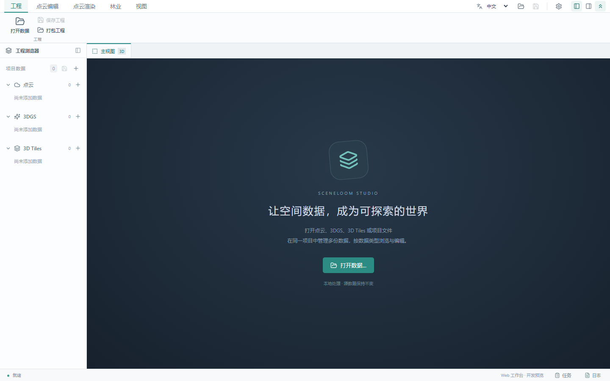
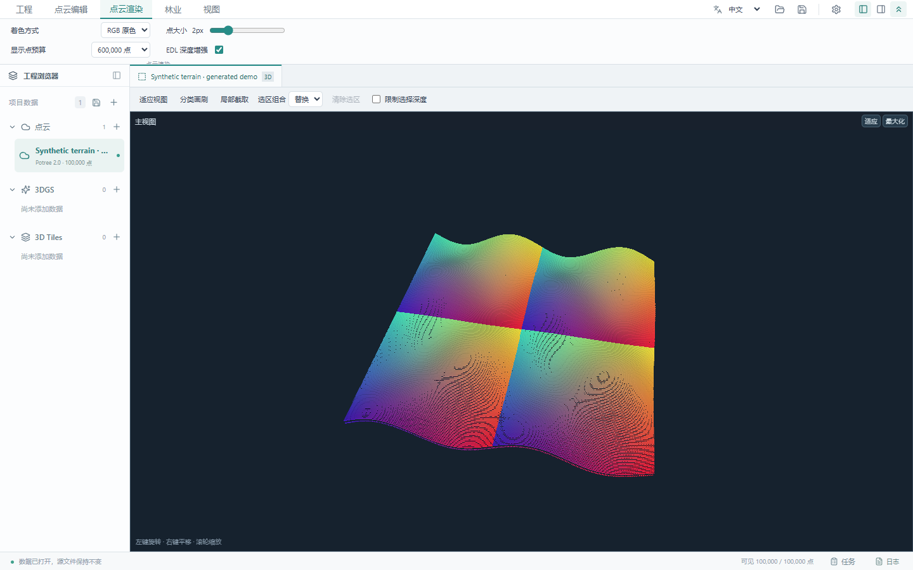
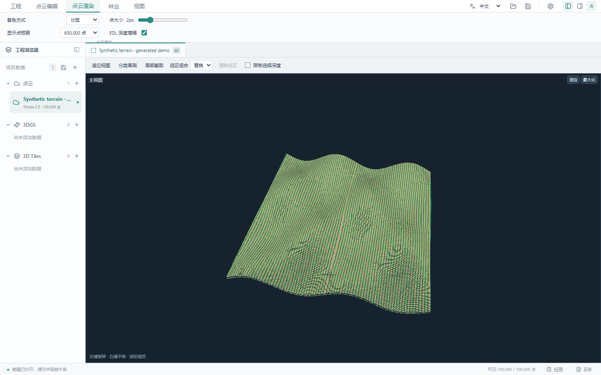

# SceneLoom Studio

**English** | [简体中文](readme_cn.md)

A local 3D workspace for point cloud editing, forestry analysis, 3D Gaussian Splatting (3DGS), and 3D Tiles visualization. Built with React, Three.js, PlayCanvas, and Tauri.

## Features

- **Point cloud editing**: on-demand Potree 2.0 loading, RGB / elevation / classification coloring, EDL, rectangle and polygon selections, classification brushes, local four-view editing, and undo/redo.
- **Forestry analysis**: manual tree IDs and point assignments, CHM treetop detection and crown segmentation, tiled processing with boundary fusion, and previews before applying results.
- **3D Gaussian Splatting**: an integrated SuperSplat editor with Gaussian PLY / SSProj support, selection, brushes, transforms, project saving, and multiple export formats. Requires WebGPU.
- **3D Tiles**: local tileset.json, B3DM / GLB, nested tilesets, LOD controls, and wireframe display.
- **Project management**: SQLite edit history, portable point cloud projects, references to multiple datasets, task panels, external tools, Chinese / English UI, and Windows portable builds.

## Screenshots

These are screenshots of the running application. All point clouds are generated from mathematical functions using fictional names and local coordinates. No real survey data, private project paths, or customer information is shown.

Workspace:



Synthetic terrain in RGB:



Synthetic terrain with demonstration classifications:



## Quick start

Requires **Node.js 24+** (built-in SQLite) and a modern browser with WebGL support.

```bash
git clone https://github.com/yeyan00/SceneLoom-studio.git
cd SceneLoom-studio
npm ci
npm run dev
```

Open <http://127.0.0.1:5173>. In Windows PowerShell, use `npm.cmd` if execution policies block npm.ps1. A local Node server provides filesystem access; the application currently targets local use.

```bash
npm run build
npm run preview
npm test
```

## Data and projects

| Type | Supported import entry points |
| --- | --- |
| Point clouds | Potree 2.0 metadata.json / directory; LAS / LAZ through a local converter |
| 3DGS | Gaussian PLY, SSProj |
| 3D Tiles | tileset.json / directory |
| Projects | SceneLoom project entry JSON |

LAS / LAZ conversion requires a separately installed PotreeConverter. Set `POTREE_CONVERTER` to its executable path; see the [converter build guide](docs/potree-converter-build.md). Ordinary point cloud PLY, XYZ / TXT, and legacy cloud.json imports are not yet supported.

Point cloud edits are stored separately from read-only source data. Multi-dataset projects save references, so keep the referenced files when moving projects or use point cloud project packaging. Save 3DGS projects separately; they are not included in point cloud packages.

## Development and verification

Most detailed implementation guides are currently in Chinese.

- [Testing](tests/README.md)
- [Project storage and packaging](docs/工程存储与打包.md), [classification label sets](docs/分类标签集管理.md)
- [Forestry editing](docs/林业插件与人工单木编辑.md), [CHM segmentation](docs/CHM单木分割.md)
- [3DGS integration](docs/3DGS显示与视图框架.md), [3D Tiles](docs/3DTiles加载.md)
- [Windows desktop builds](docs/desktop-build.md), [tool registration](tools/plugins/README.md)

To reproduce the screenshots, run `npm run build`, then `node scripts/capture-readme.mjs`. This requires Playwright and a local Chrome installation. The script uses generated data and isolated settings, then removes temporary data.

## Publishing and privacy

The repository excludes private point clouds, models, project databases, converter binaries, dependencies, build packages, and machine settings. The ignore rules cover common data and key formats. Review tracked files before publishing, since ignore rules do not affect files already tracked by Git.

The project is under active development. CHM outputs candidate crowns; without ground-truth annotations, they do not establish segmentation accuracy. Large areas remain subject to raster limits. BROTLI point clouds and complete standard-format export are not yet implemented.

## References and third-party licenses

SceneLoom Studio uses or adapts work from these projects. Their copyright and license notices are retained:

| Project | Usage | License and retained notice |
| --- | --- | --- |
| [Potree](https://github.com/potree/potree) | Reference for the Potree 2.0 reader and adapted EDL shading | BSD 2-Clause — [license](third_party/POTREE-LICENSE.txt) |
| [SuperSplat](https://github.com/playcanvas/supersplat) | Embedded 3D Gaussian Splatting editor | MIT — [license](public/licenses/SUPERSPLAT-LICENSE.txt), [source and modifications](vendor/supersplat/README.md) |
| [3d-tiles-renderer / 3DTilesRendererJS](https://github.com/NASA-AMMOS/3DTilesRendererJS) | 3D Tiles rendering | Apache-2.0 — [license](public/licenses/3D-TILES-RENDERER-LICENSE.txt) |

Additional dependencies include Three.js, PlayCanvas, React, and Tauri. See [third-party provenance](third_party/README.md) and [distributed license notices](public/licenses). When redistributing these components, retain their applicable license and copyright notices. These acknowledgments do not replace the upstream license terms.
