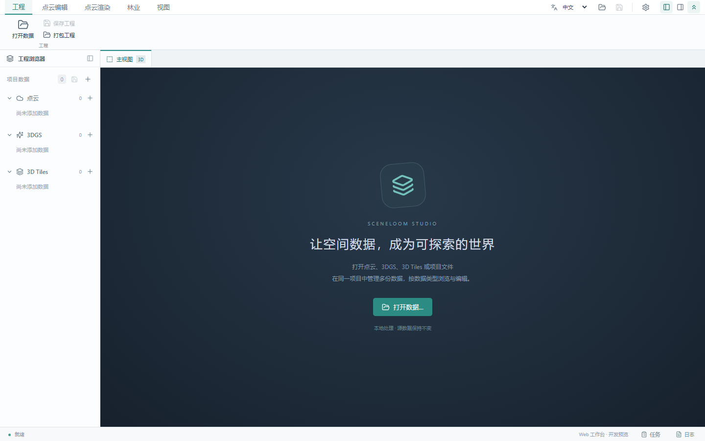
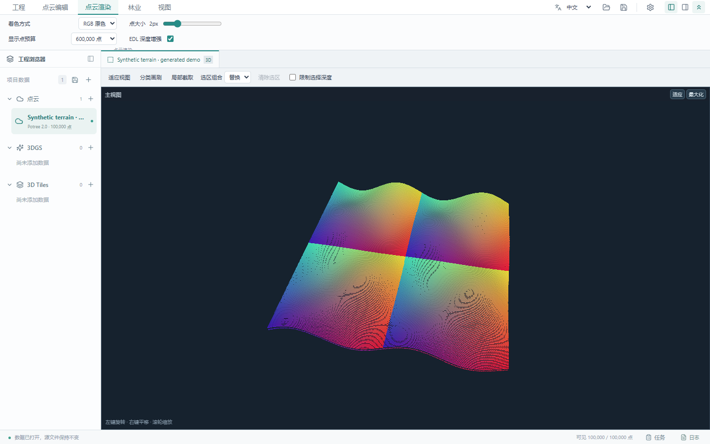
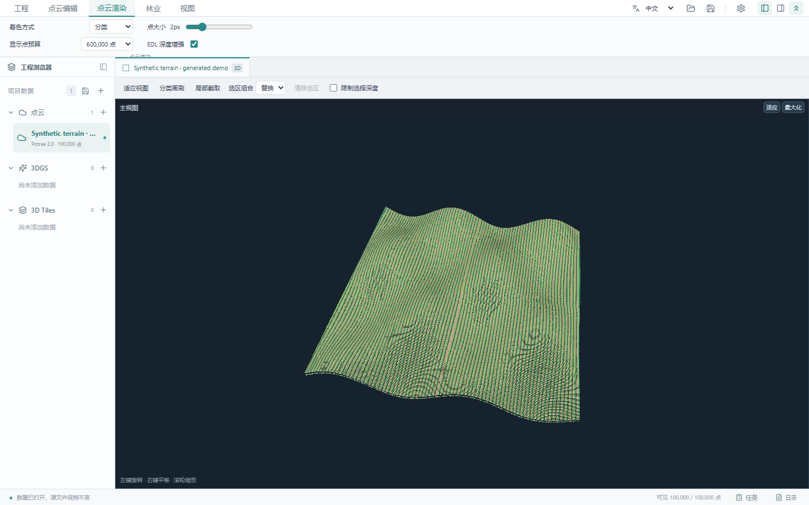

# SceneLoom Studio · 景织

[English](README.md) | **简体中文**

面向点云编辑、林业单木分析、3D Gaussian Splatting（3DGS）与 3D Tiles 浏览的本地三维工作台。

A local 3D workspace for point cloud editing, forestry analysis, 3D Gaussian Splatting and 3D Tiles visualization. Built with React, Three.js, PlayCanvas and Tauri.

## 功能

- **点云编辑**：Potree 2.0 按需读取、RGB / 高程 / 分类着色、EDL、矩形与多边形选择、分类画刷、局部四视图、撤销重做。
- **林业分析**：人工单木编号与归属编辑、CHM 树顶检测与冠区分割、分块融合、预览确认。
- **3DGS**：独立视图集成 SuperSplat，支持 Gaussian PLY / SSProj、选择、画刷、变换、工程保存及多种格式导出，需要 WebGPU。
- **3D Tiles**：本地 tileset.json、B3DM / GLB、嵌套瓦片、LOD 与线框显示。
- **工程管理**：SQLite 编辑历史、工程打包、多数据引用、任务面板、工具扩展、中英文界面与 Windows 便携版构建。

## 截图

以下均为实际应用截图。点云由数学函数生成，使用虚构名称和局部坐标，不含真实采集数据、项目路径或客户信息。

工作区：



合成地形 RGB：



合成地形分类着色（类别仅供演示）：



## 快速开始

需要 **Node.js 24+**（内置 SQLite）和支持 WebGL 的现代浏览器。

```bash
git clone https://github.com/yeyan00/SceneLoom-studio.git
cd SceneLoom-studio
npm ci
npm run dev
```

访问 <http://127.0.0.1:5173>。Windows PowerShell 如拦截 npm.ps1，可改用 `npm.cmd`。应用通过本地 Node 服务读取文件，当前面向本机使用。

```bash
npm run build
npm run preview
npm test
```

## 数据与工程

| 类型 | 当前导入入口 |
| --- | --- |
| 点云 | Potree 2.0 metadata.json / 目录；LAS / LAZ 先经本地转换器转换 |
| 3DGS | Gaussian PLY、SSProj |
| 3D Tiles | tileset.json / 目录 |
| 工程 | SceneLoom 工程入口 JSON |

LAS / LAZ 转换需要单独准备 PotreeConverter，可用 `POTREE_CONVERTER` 指定路径，详见[转换器说明](docs/potree-converter-build.md)。普通点云 PLY、XYZ / TXT、旧版 cloud.json 尚未接入导入。

点云编辑保存到独立工程状态，源点云保持只读；多数据项目保存的是引用，迁移时需携带关联数据或使用工程打包。3DGS 工程需独立保存，尚未纳入点云打包。

## 开发与验证

- [测试说明](tests/README.md)
- [工程存储与打包](docs/工程存储与打包.md)、[分类标签集](docs/分类标签集管理.md)
- [林业编辑](docs/林业插件与人工单木编辑.md)、[CHM 分割](docs/CHM单木分割.md)
- [3DGS](docs/3DGS显示与视图框架.md)、[3D Tiles](docs/3DTiles加载.md)
- [Windows 桌面构建](docs/desktop-build.md)、[工具注册](tools/plugins/README.md)

截图复现：先 `npm run build`，再 `node scripts/capture-readme.mjs`，需要 Playwright 与本机 Chrome。脚本使用生成数据与隔离配置，结束后清理临时数据。

## 发布与隐私

仓库不包含真实点云、模型、工程数据库、转换器二进制、依赖、构建包或本机配置。`.gitignore` 屏蔽常见数据和密钥格式；上传前仍应检查索引，因为已跟踪文件不受忽略规则影响。

当前处于持续开发阶段。CHM 输出是候选冠区，没有人工真值时不代表准确率；超大范围仍有栅格限制。BROTLI 点云、完整标准格式导出等能力尚未实现。

## 参考项目与第三方许可

SceneLoom Studio 使用或参考了以下项目，并保留相应版权及许可声明：

| 项目 | 用途 | 许可与保留声明 |
| --- | --- | --- |
| [Potree](https://github.com/potree/potree) | Potree 2.0 读取器参考与 EDL 着色适配 | BSD 2-Clause — [许可原文](third_party/POTREE-LICENSE.txt) |
| [SuperSplat](https://github.com/playcanvas/supersplat) | 内嵌 3D Gaussian Splatting 编辑器 | MIT — [许可原文](public/licenses/SUPERSPLAT-LICENSE.txt)、[来源与修改说明](vendor/supersplat/README.md) |
| [3d-tiles-renderer / 3DTilesRendererJS](https://github.com/NASA-AMMOS/3DTilesRendererJS) | 3D Tiles 渲染 | Apache-2.0 — [许可原文](public/licenses/3D-TILES-RENDERER-LICENSE.txt) |

其他依赖包括 Three.js、PlayCanvas、React 与 Tauri。完整来源见 [third_party](third_party/README.md)，分发声明见 [public/licenses](public/licenses)。再分发这些组件时应保留适用的许可与版权声明；本节致谢不能替代上游许可条款。
